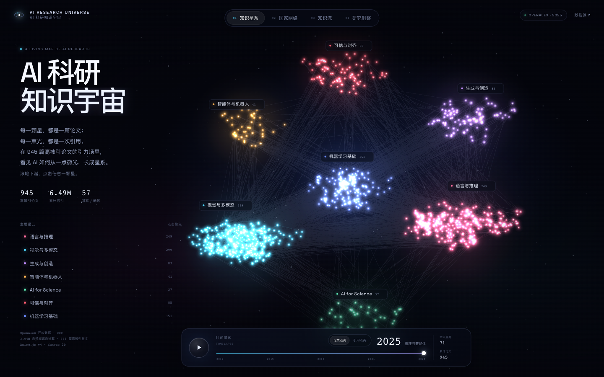
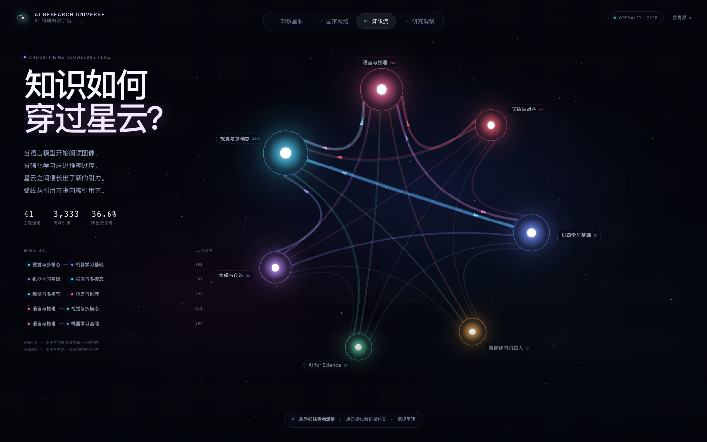
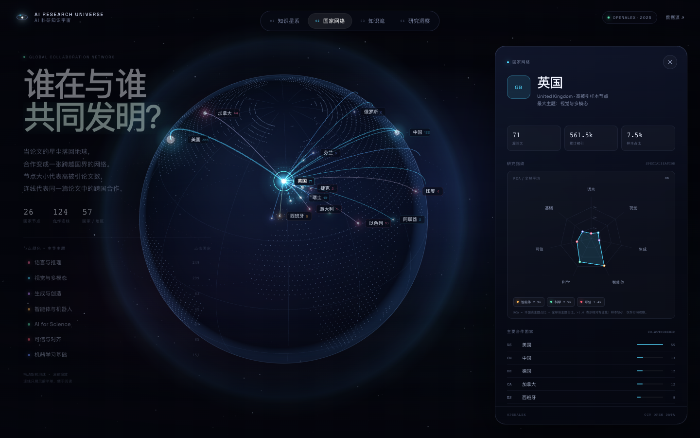
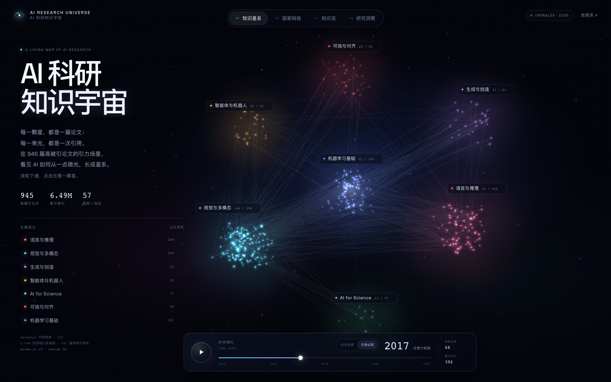
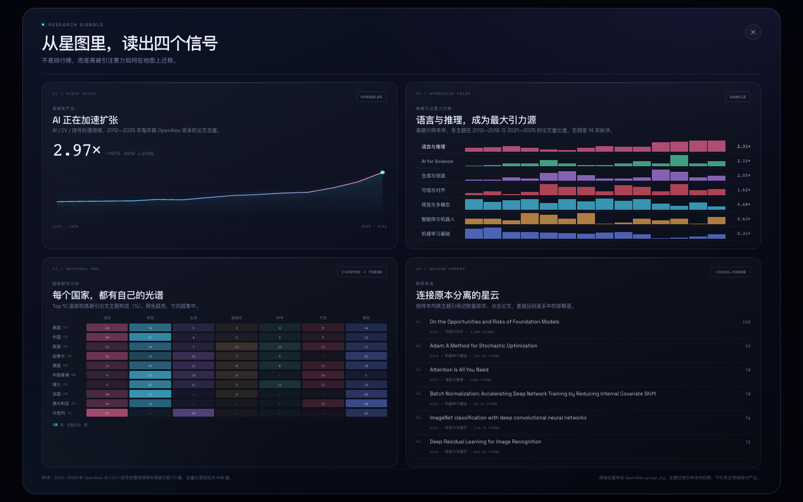
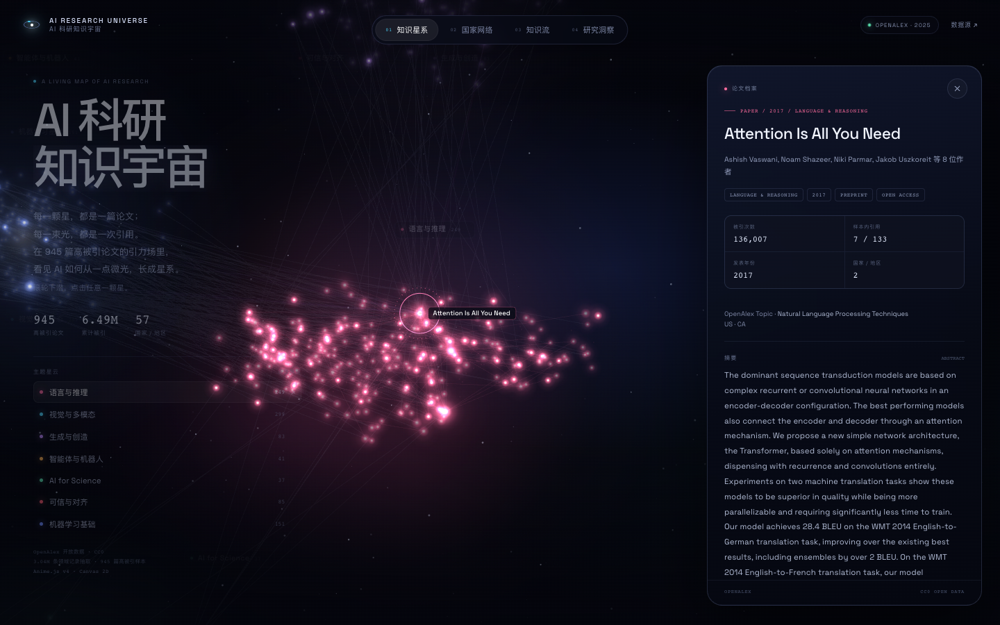
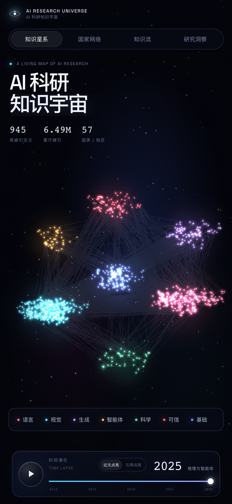

# AI 科研知识宇宙 · AI Research Universe

一个用 **Anime.js v4 + Canvas 2D + OpenAlex 开放数据** 制作的交互式科研知识星系。

把 2012—2025 年 AI / 计算机视觉 / 信号处理领域的高被引论文，组织成 7 个主题星云、9,111 条真实引用关系、一张可旋转的国际合作网络和一张跨主题知识流图。每一颗星是一篇论文，每一次缩放都是一次从领域全景到论文摘要的下潜。

新增：**论文点亮 / 引用点亮**双时间模式、**跨星云知识流**、**国家研究指纹 RCA**。

## 交付文件

- **项目交付文档（四部分合并 Word）**：[AI科研知识宇宙-项目交付文档.docx](AI科研知识宇宙-项目交付文档.docx)
- **需求文档**：[DOCX](docs/01-需求文档.docx) · [PDF](docs/01-需求文档.pdf) · [Markdown](docs/01-需求文档.md)
- **可运行组件代码**：[index.html](index.html)（+ `css/`、`js/`、`vendor/`）
- **可运行交互测试页面**：[test.html](test.html)（需通过本地 HTTP 服务器访问）
- **合作分工**：[DOCX](docs/04-合作分工.docx) · [PDF](docs/04-合作分工.pdf) · [Markdown](docs/04-合作分工.md)
- **配套说明**：[组件说明](docs/02-组件说明.md) · [测试说明](docs/03-测试说明.md) · [交付清单](docs/交付清单.md)

## 预览



| 跨星云知识流 | 国家研究指纹 |
| --- | --- |
|  |  |

| 引用点亮 · 2017 | 研究洞察 |
| --- | --- |
|  |  |

| 论文下潜 | 移动端 |
| --- | --- |
|  |  |

## 运行

无需构建、无需联网：

```bash
# 方式一：直接打开
open index.html

# 方式二：本地静态服务器（推荐用于展示）
python3 -m http.server 8000
# 访问 http://localhost:8000
```

## 交互

| 操作 | 效果 |
| --- | --- |
| 拖拽空白区域 | 旋转知识星系 / 地球 |
| 滚轮 / 双指捏合 | 从领域全景逐级放大；放大后出现论文标签 |
| 悬停星星 | 查看论文标题、年份、引用数，并点亮引用网络 |
| 点击星星 | 聚焦论文，打开摘要、作者、主题、样本内引用网络 |
| 点击主题图例 / 星云标签 | 聚焦主题星云，查看最亮论文与主题笔记 |
| 点击「国家网络」 | 星系重组为国际合作地球；点击国家节点查看国家画像与研究指纹 |
| 国家网络自动旋转 | 默认绕北极—南极连线自转（15 秒/圈）；右下角「锁定自转」固定视角，再次点击恢复 |
| 点击「知识流」 | 七个星云排成圆环，弧线表示跨主题引用方向；点击节点/弧线查看流量与桥梁论文 |
| 点击「研究洞察」 | 查看领域产出、注意力迁移、国家 × 主题矩阵与跨界桥梁论文 |
| 打开 `test.html` | 在 iframe 预览旁自动执行 8 项交互验收，也可手动重新检测 |
| 论文点亮 / 引用点亮 | 两种时间语义：发表即满亮，或按 `counts_by_year` 的逐年被引累积点亮 |
| 时间轴 / 播放键 | 2012 → 2025 演化播放；新论文从星系中心诞生并向外扩张 |
| `Space` / `Esc` / `←` `→` | 播放暂停 / 返回 / 切换年份 |

移动端使用底部横向主题胶囊切换主题，点按并拖拽地球旋转。

## 数据与方法

- **数据源**：OpenAlex Works API（CC0）。使用 `primary_topic.subfield.id` = Artificial Intelligence、Computer Vision and Pattern Recognition、Signal Processing，按年取 `cited_by_count` 前 70 篇，并补入 14 篇 AI for Science 地标论文；去重、清理明显跨领域噪声后得到 **945 篇**论文；引用数为 OpenAlex 当前记录值。
- **领域总量**：`group_by=publication_year` 得到 2012—2025 年约 **304 万**条记录，用于「AI 正在加速扩张」卡片，不依赖样本。
- **引用网络**：样本内真实 `referenced_works` 交集，共 **9,111 条**。主画布为可读性选取 **1,500 条**代表边；悬停/选中论文时使用完整邻接关系。
- **引用点亮**：为 945 篇论文补抓 OpenAlex `counts_by_year`，计算截至当前年份的累计被引与当年被引热度；星星在发表后逐渐变亮，而不是一次点亮。2025 年之后的数据不计入时间轴。
- **跨主题知识流**：9,111 条引用中，有 **3,333 条**的引用方与被引用方属于不同主题，形成 **41 条有向主题通道**。弧线颜色取引用方主题，箭头指向被引用方；面板中的桥梁论文按被引量排序。
- **主题划分**：OpenAlex `primary_topic` + 标题关键词规则，辅以经典论文人工校正，归入 7 个宏观主题：语言与推理、视觉与多模态、生成与创造、智能体与机器人、AI for Science、可信与对齐、机器学习基础。主题是策展用的宏观聚类，不是 OpenAlex 官方分类。
- **国家网络**：`country` 取第一作者首个机构的国家；合作边为同一篇论文中多个国家代码的共现。地球只绘制前半球连线，避免球体背面造成误读。
- **国家研究指纹**：用 RCA（Revealed Comparative Advantage）替代单一占比：`RCA = 本国该主题占比 ÷ 全球该主题占比`。RCA > 1 表示相对专业化；雷达图使用固定 4× 上限，样本较小时只作方向观察。
- **洞察口径**：主题增长与注意力迁移是 **样本内份额**，用于观察高被引注意力的相对迁移，不代表全领域绝对产出；领域总量卡片是 OpenAlex 全量统计。
- **位置**：星系位置是按年份、主题与稳定哈希生成的叙事性螺旋布局，不是 UMAP/t-SNE，也不表示严格的语义距离。引用边、年份、国家和主题强度均来自数据。

完整数据快照日期：2026-11-11。生成后的轻量数据在 `js/data.js`；采集与清洗脚本保留在 `data/`、`data2/`。

## 技术

- **Anime.js v4**：开场时间线、相机飞行、年度论文诞生、粒子脉冲、两种点亮模式切换、详情面板条形图、洞察 SVG 路径绘制与交错入场。
- **Canvas 2D**：3D 透视投影的星云、星点、引用曲线、跨主题有向弧线、地球经纬网与跨国弧线。
- **交互模型**：四视图状态机（星系 / 国家 / 知识流 / 洞察），支持悬停命中、曲线弧命中与详情面板联动。
- **零构建静态页面**：本地字体与 Anime.js 已 vendor，断网也能完整演示。
- 响应式三档布局：桌面 1440 / 平板 768 / 手机 390。

## 文件

```
index.html          页面结构与 HUD
css/style.css       视觉系统、主题、响应式布局
js/app.js           星图渲染、交互、Anime.js 时间线
js/data.js          945 篇论文 + 逐年被引 hist + 9,111 条引用 + 国家/洞察数据
vendor/anime.min.js Anime.js v4.0.2
vendor/fonts/       Space Grotesk
data/ data2/        OpenAlex 原始采集、逐年引用历史与生成脚本（开发工作区）
shots/              展示截图

> 交付 ZIP 只包含运行所需文件与文档；`data/`、`data2/` 的原始抓取缓存留在开发工作区，不随运行包分发。
```

## 致谢

- [OpenAlex](https://openalex.org/)：开放科研知识图谱，数据 CC0。
- [Anime.js](https://animejs.com/)：MIT License。
- [Natural Earth](https://www.naturalearthdata.com/) 1:110m land：用于生成地球陆地点阵，public domain。
- 字体 Space Grotesk：SIL Open Font License。

> 这是课程设计 / 科技主题展览取向的科研可视化作品：数据真实、口径透明，叙事与视觉为策展服务。
