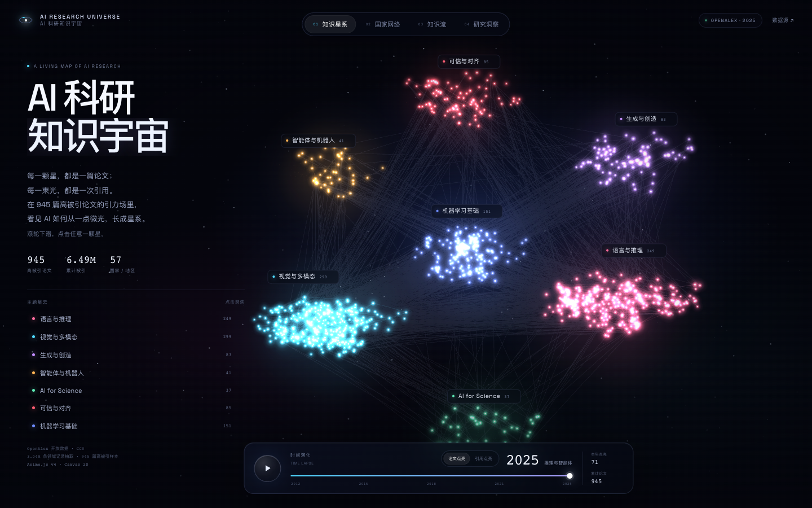
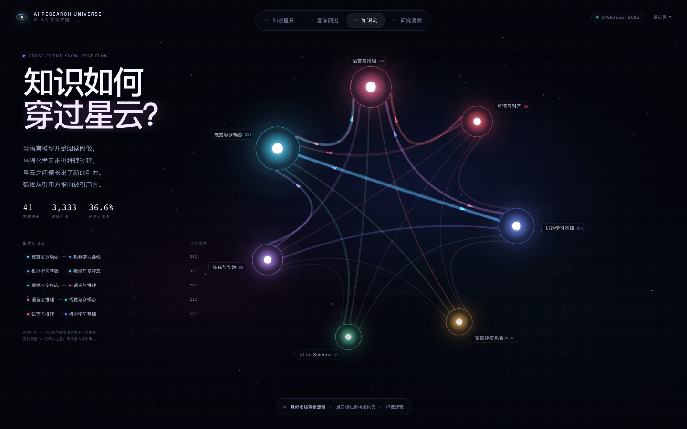
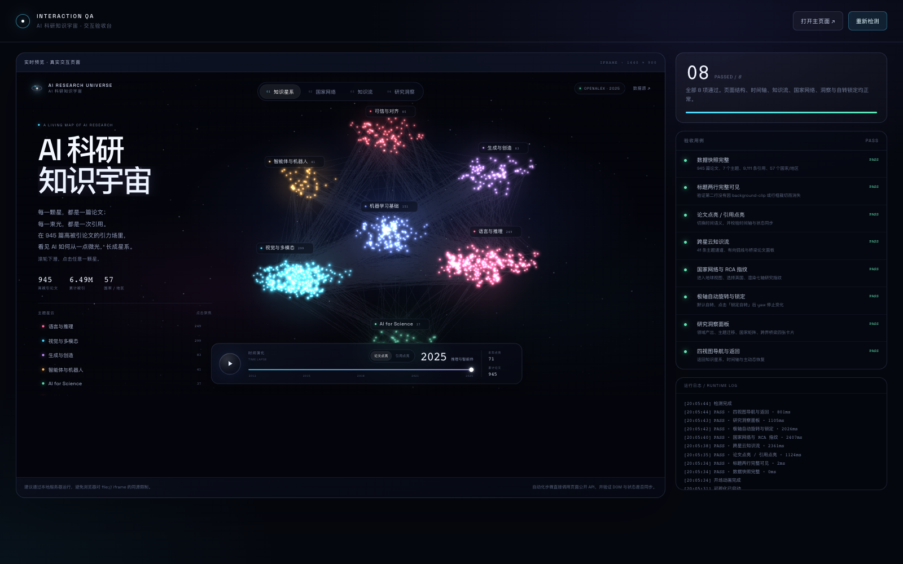

# AI 科研知识宇宙 · 需求文档

> 基于 OpenAlex 与 Anime.js 的科研知识可视化  
> 版本 V1.0 · 2026-11-11 · 单人项目

## 摘要

本项目把 2012—2025 年 AI / 计算机视觉 / 信号处理领域的高被引论文组织成一座可探索的“知识星系”：7 个主题星云、945 篇论文、9,111 条真实引用关系、57 个国家/地区，以及 3,333 条跨主题引用。用户可以从领域全景逐级下潜到论文摘要，也可以切换到国家网络、跨星云知识流和研究洞察。

核心不是做论文排行榜，而是回答四个问题：

1. 哪些研究主题正在快速增长？
2. 不同国家分别擅长哪些方向？
3. 哪些论文连接了原本分离的研究领域？
4. 一个热点从出现到爆发，经历了什么过程？

完整排版版见 [01-需求文档.docx](01-需求文档.docx)。

## 1. 项目背景

AI 研究同时表现为三种规模：

- **产出规模**：本作品覆盖的 OpenAlex AI / CV / 信号处理领域，2012—2025 年约 304 万条记录；年产出从约 14.5 万条增长到 43.1 万条，约 2.97 倍。
- **引用规模**：945 篇高被引样本累计约 648 万次引用，形成 9,111 条样本内引用关系。
- **知识规模**：语言、视觉、生成、智能体、AI for Science、可信 AI、机器学习基础不断相互渗透，创新越来越多地发生在学科交界处。

OpenAlex 是 CC0 的开放科研知识图谱，官方快照约 6.26 亿条记录。传统文献计量页面通常只回答“谁最高”“哪年最多”，无法同时呈现规模、时间、地理、引用和主题五种维度。因此项目选择“知识星系”作为可操作的信息结构：相似论文聚成星云，引用关系形成光链，时间播放让新论文从中心诞生，国家网络让星尘落回地球。

## 2. 目标与用户

### 2.1 项目目标

- **可进入**：打开页面即看到整体星图，而不是需要阅读说明的图例。
- **可讲述**：用时间轴、国家网络、知识流和洞察串起“出现—扩散—爆发—连接”的叙事。
- **可验证**：每个数字、每条引用、每个国家指标都能追溯到 OpenAlex 记录。
- **可展示**：桌面 / 平板 / 手机三档布局，适配课程答辩和科技展。

### 2.2 用户场景

| 用户 / 场景 | 核心需求 | 页面回应 |
| --- | --- | --- |
| 课程答辩评委 | 理解选题、数据方法与创新点 | 总览 → 洞察 → 测试页 |
| 科技展观众 | 无需教程也能被吸引 | 默认自转、悬停提示、主题胶囊 |
| 研究者 / 同学 | 查找方向、国家或论文 | 主题聚焦、国家画像、论文摘要 |
| 课程教师 | 检查真实性与可复现性 | README、需求文档、test.html |

## 3. 功能需求

| 编号 | 功能 | 说明 | 优先级 |
| --- | --- | --- | --- |
| F01 | 知识星系 | 945 篇论文按 7 个主题聚类，真实引用连线 | P0 |
| F02 | 语义缩放 | 领域 → 主题 → 论文 → 摘要逐级显示 | P0 |
| F03 | 论文档案 | 标题、作者、年份、引用、摘要、引用网络 | P0 |
| F04 | 双时间语义 | 论文点亮 / 引用点亮切换 | P0 |
| F05 | 国家网络 | 可旋转地球、合作弧线、国家画像 | P0 |
| F06 | 极轴自转与锁定 | 默认 15 秒/圈，按钮锁定/恢复 | P1 |
| F07 | 国家研究指纹 | RCA 雷达展示相对专业化 | P1 |
| F08 | 跨星云知识流 | 41 条有向通道、桥梁论文面板 | P0 |
| F09 | 研究洞察 | 领域增长、注意力迁移、国家矩阵、桥梁 | P1 |
| F10 | 响应式 | 1440 / 1024 / 768 / 390 四档 | P1 |
| F11 | 数据说明 | 样本口径、RCA 公式、边筛选 | P1 |
| F12 | 交互测试页 | test.html 自动验收 8 项 | P1 |

**非功能要求**：无需后端与安装；断网可运行；1440×900 下 Canvas 动画保持 60fps 量级；现代 Chrome / Edge / Safari；数据透明。

## 4. 信息与可视化设计

| 视觉元素 | 数据含义 | 交互含义 |
| --- | --- | --- |
| 星云 / 颜色 | 7 个宏观主题 | 点击聚焦 |
| 星点 | 一篇论文；大小映射被引 | 悬停看标题；点击看摘要 |
| 引用光链 | 样本内真实引用 | 悬停点亮一阶邻接 |
| 时间轴 | 2012—2025 | 播放、拖动、切换双时间语义 |
| 地球节点 | 第一作者国家 | 点击看国家画像 / RCA |
| 知识流弧线 | 主题 A → 主题 B 的有向流量 | 点击看桥梁论文 |
| RCA 雷达 | 本国主题占比 ÷ 全球主题占比 | 读相对专业化 |

### 四个视图

| 视图 | 回答的问题 | 主要视觉 |
| --- | --- | --- |
| 知识星系 | 整体长什么样？热点在哪里？ | 7 个星云、引用光链、时间轴 |
| 国家网络 | 谁在与谁合作？各国擅长什么？ | 可旋转地球、合作弧线、RCA 雷达 |
| 知识流 | 知识如何穿过星云？ | 圆环节点、41 条有向通道 |
| 研究洞察 | 有哪些可被讲述的研究信号？ | 领域曲线、主题脉冲、国家矩阵、桥梁榜 |

## 5. 数据口径

- **样本**：OpenAlex AI / CV / 信号处理，按年取 cited_by_count 前 70 篇，并补入 14 篇 AI for Science 地标论文；去重、清洗后 945 篇，各年 64—77 篇。
- **引用**：样本内真实 `referenced_works` 交集 9,111 条；主画布显示 1,500 条代表边，详情使用完整邻接。
- **双时间语义**：补抓 `counts_by_year`，引用点亮只统计到 2025 年。
- **主题**：OpenAlex topic + 标题关键词规则 + 经典论文人工校正，属于策展聚类，不是官方分类。
- **国家**：第一作者首个机构的国家；合作边为同篇论文多个国家代码共现。
- **RCA**：`本国主题占比 ÷ 全球主题占比`；>1 表示相对专业化，固定 4× 雷达上限，样本较小时只作方向观察。
- **位置**：按年份、主题与稳定哈希生成的叙事性螺旋布局，不是 UMAP / t-SNE，也不表示严格语义距离。

## 6. 技术方案

| 模块 | 职责 |
| --- | --- |
| `index.html` | 页面骨架、四视图、HUD、时间轴、详情、洞察覆盖层 |
| `css/style.css` | 深空视觉、布局、响应式、面板与图表样式 |
| `js/app.js` | Canvas 投影、状态机、交互命中、Anime.js 时间线、国家 / 知识流 / 洞察 |
| `js/data.js` | 945 篇论文、逐年被引 hist、9,111 条边、国家与洞察数据 |
| `test.html` | iframe 交互验收台，自动测试 8 项 |
| `vendor/anime.min.js` | Anime.js v4.0.2，本地化 |

**Anime.js 使用**：开场 HUD/标题、相机飞行、论文诞生、时间批次、主题脉冲、面板滑入、洞察 SVG 路径绘制。Canvas 使用缓存 sprite、主题分批描边和完整邻接按需切换，保证 60fps 量级。

## 7. 项目亮点

1. **双时间语义**：同一批星星，既可看“何时发表”，也可看“何时被看见”。
2. **知识流**：3,333 条跨主题引用聚合成 41 条有向通道，避免毛线球。
3. **RCA 国家指纹**：从数量排名推进到相对研究方向结构。
4. **可讲述的层级**：领域 → 主题 → 论文 → 摘要。
5. **展陈级默认行为**：国家网络 15 秒/圈极轴自转，可一键锁定。
6. **可验证交付**：test.html 的 8 项自动验收覆盖核心交互。

## 8. 验收

| 编号 | 验收项 | 标准 |
| --- | --- | --- |
| T01 | 数据快照 | 945 / 7 / 9,111 / 57 |
| T02 | 标题完整性 | 两行标题可见，第二行不透明 |
| T03 | 双时间语义 | 切换、年份与 DOM 同步 |
| T04 | 知识流 | flow 视图、通道详情、桥梁论文 |
| T05 | 国家网络 & RCA | 选中英国、雷达与专业化标签存在 |
| T06 | 自转与锁定 | 默认 yaw 变化，锁定后停止，可恢复 |
| T07 | 研究洞察 | 4 张卡片、曲线、矩阵 |
| T08 | 返回清理 | 时间轴与视图状态恢复 |

## 9. 风险与限制

- 高被引样本不代表全领域绝对产出；
- 主题规则为启发式，少量论文归属可讨论；
- RCA 样本较小，不做因果推断；
- 国家取第一作者机构，多机构论文只归一个主国家；
- 星系位置为叙事布局，不表示严格语义距离；
- OpenAlex 引用数随快照变化，作品记录快照日期与时间窗口。

## 10. 交付物

| 交付物 | 文件 |
| --- | --- |
| 需求文档 | `docs/01-需求文档.docx` / `.md` |
| 可运行组件代码 | `index.html` + `css/` + `js/` + `vendor/` |
| 交互测试页面 | `test.html` |
| 合作分工 | `docs/04-合作分工.docx` / `.md` |
| 组件说明 | `docs/02-组件说明.md` |
| 测试说明 | `docs/03-测试说明.md` |

## 附录：领域年度产出

| 年份 | 领域记录数 | 样本论文数 | 累计 |
| --- | --- | --- | --- |
| 2012 | 144,995 | 65 | 65 |
| 2013 | 148,922 | 65 | 130 |
| 2014 | 151,148 | 64 | 194 |
| 2015 | 152,726 | 67 | 261 |
| 2016 | 167,242 | 67 | 328 |
| 2017 | 162,803 | 68 | 396 |
| 2018 | 184,706 | 64 | 460 |
| 2019 | 205,062 | 66 | 526 |
| 2020 | 214,694 | 67 | 593 |
| 2021 | 229,170 | 71 | 664 |
| 2022 | 236,176 | 67 | 731 |
| 2023 | 278,789 | 77 | 808 |
| 2024 | 337,428 | 66 | 874 |
| 2025 | 431,014 | 71 | 945 |

参考资料：OpenAlex · Anime.js v4 · Natural Earth 1:110m land。
