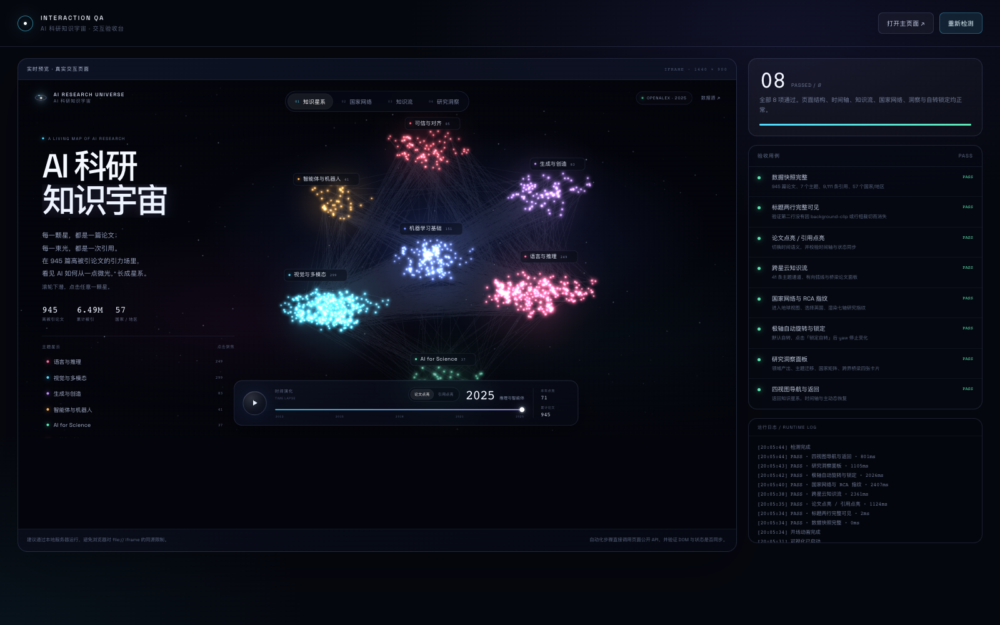

# 交互测试说明

## 1. 测试入口

```bash
cd 项目根目录
python3 -m http.server 8000
```

浏览器访问：

```text
http://localhost:8000/test.html
```

> 不要直接双击 `test.html`：测试页需要通过同源 iframe 读取 `index.html` 的页面状态；`file://` 可能被浏览器安全策略阻止。主页面 `index.html` 可以直接双击打开。

## 2. 测试页做什么

`test.html` 左侧是 1440×900 的真实 iframe 预览，右侧是验收用例与运行日志。页面加载后会自动执行 8 项测试，也可以点「重新检测」重复运行。



## 3. 自动用例

| 编号 | 用例 | 检查内容 | 预期 |
| --- | --- | --- | --- |
| T01 | 数据快照完整 | 945 篇论文、7 主题、9,111 边、57 国家 | PASS |
| T02 | 标题两行完整可见 | 两行高度 > 20px，第二行颜色不透明 | PASS |
| T03 | 论文点亮 / 引用点亮 | 点击切换，`lightMode` 与按钮、年份同步 | PASS |
| T04 | 跨星云知识流 | 进入 flows，5 条列表，打开通道详情 | PASS |
| T05 | 国家网络与 RCA 指纹 | 选中英国，RCA 雷达与专业化标签存在 | PASS |
| T06 | 极轴自转与锁定 | 默认 yaw 变化；锁定后停止；可恢复 | PASS |
| T07 | 研究洞察面板 | 4 张卡片、领域曲线、国家矩阵 | PASS |
| T08 | 四视图导航与返回 | 返回 galaxy，时间轴与 body 状态恢复 | PASS |

当前验收结果：**8 / 8 PASS**。

## 4. 手工验收清单

### 桌面 1440×900

- [ ] 页面打开后 5 秒内完成开场，标题两行完整。
- [ ] 拖拽旋转星系，滚轮放大后出现论文标签。
- [ ] 悬停星点出现卡片，引用边被点亮。
- [ ] 点击星点打开论文档案，摘要、作者、引用网络存在。
- [ ] 时间轴切到 2017，切「引用点亮」后星光变暗、切换明显。
- [ ] 点击「知识流」，hover 弧线出现流量卡片，点击打开通道详情。
- [ ] 点击「国家网络」，地球默认自转；点「锁定自转」后停止。
- [ ] 点击国家节点，RCA 雷达、合作国家、代表论文显示。
- [ ] 点击「研究洞察」，4 张卡片完整，无横向滚动。
- [ ] 按 Esc / 空白处返回，状态清理。

### 平板与手机

- [ ] 768×1024：顶部导航、主题胶囊、时间轴不重叠。
- [ ] 390×844：标题两行、底部胶囊、锁定按钮与说明胶囊不重叠。
- [ ] 手机端国家面板为全屏，关闭按钮可点击。

### 兼容与离线

- [ ] 断网刷新，页面仍能加载（字体和 Anime.js 已本地化）。
- [ ] Chrome / Safari 中标题与面板正常。
- [ ] 刷新后无控制台错误（测试页会捕获 iframe 错误）。

## 5. 常见问题

**Q：测试页提示“无法访问 iframe 内容”？**  
A：说明用 `file://` 打开了测试页。请使用 `python3 -m http.server` 后访问 `http://localhost:8000/test.html`。

**Q：主页面打开后没有动画？**  
A：检查浏览器是否开启“减少动态效果”；页面会尊重 `prefers-reduced-motion`，此时直接进入静态视图。

**Q：为什么国家网络只有前半球连线？**  
A：为了避免球体背面的弧线造成误读。完整合作数据仍保留在国家面板中。
